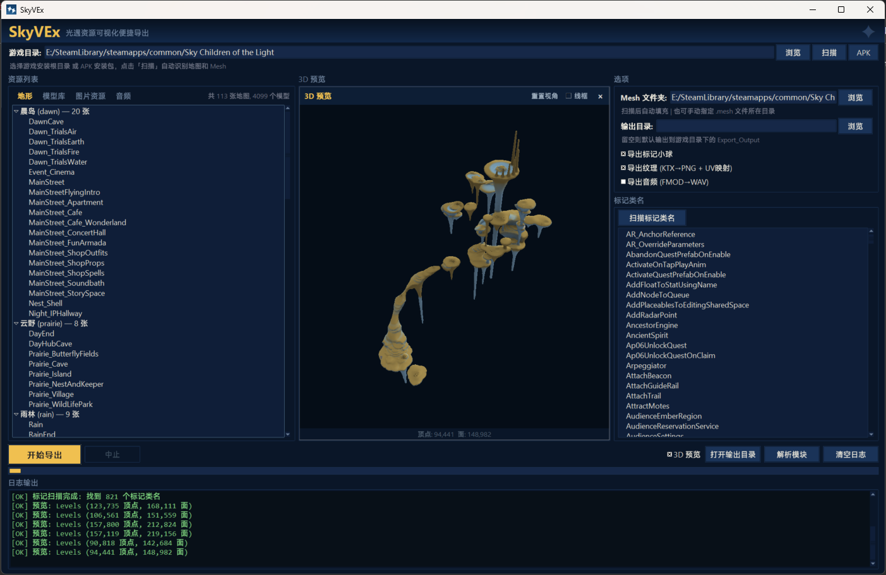
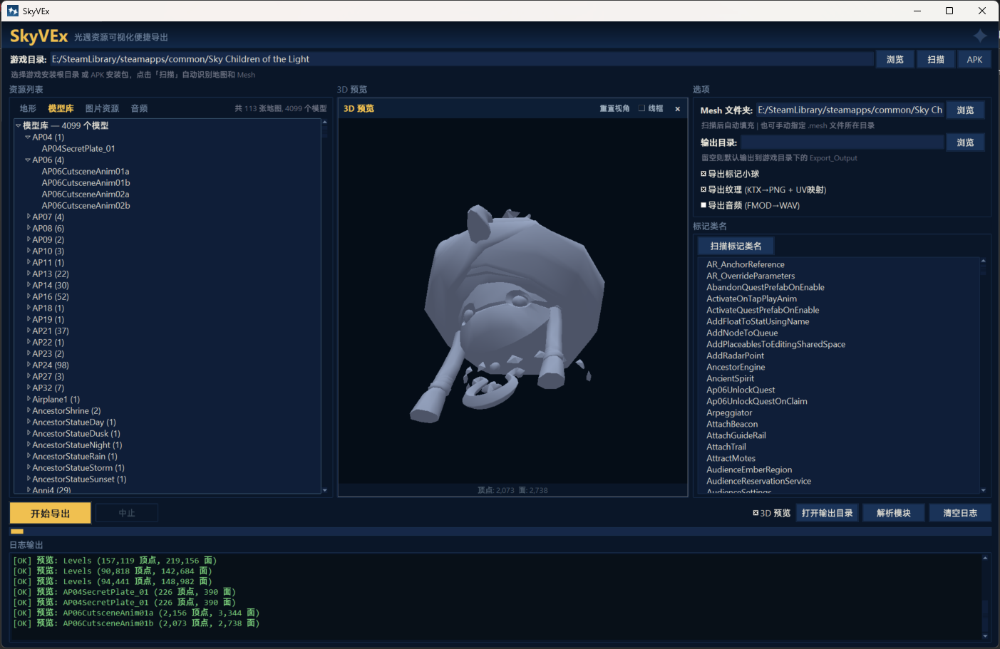
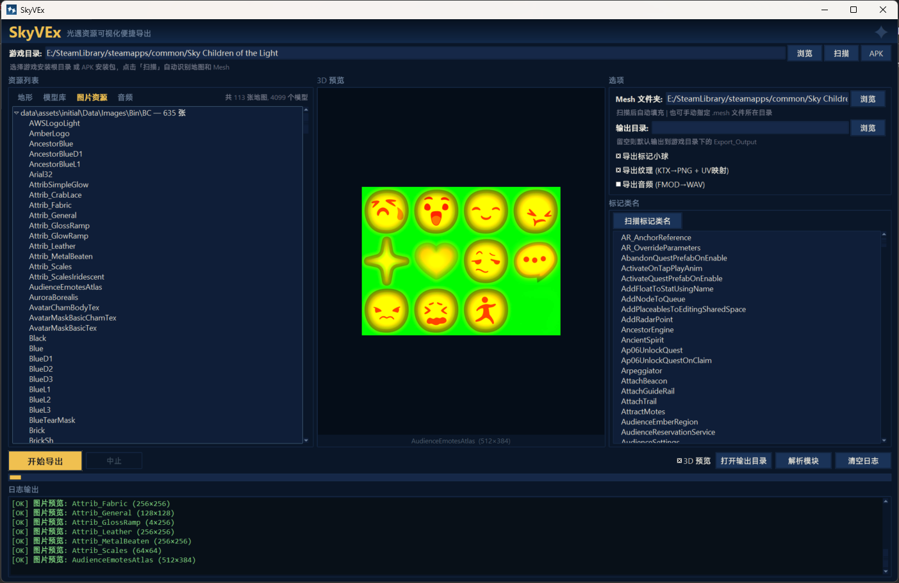
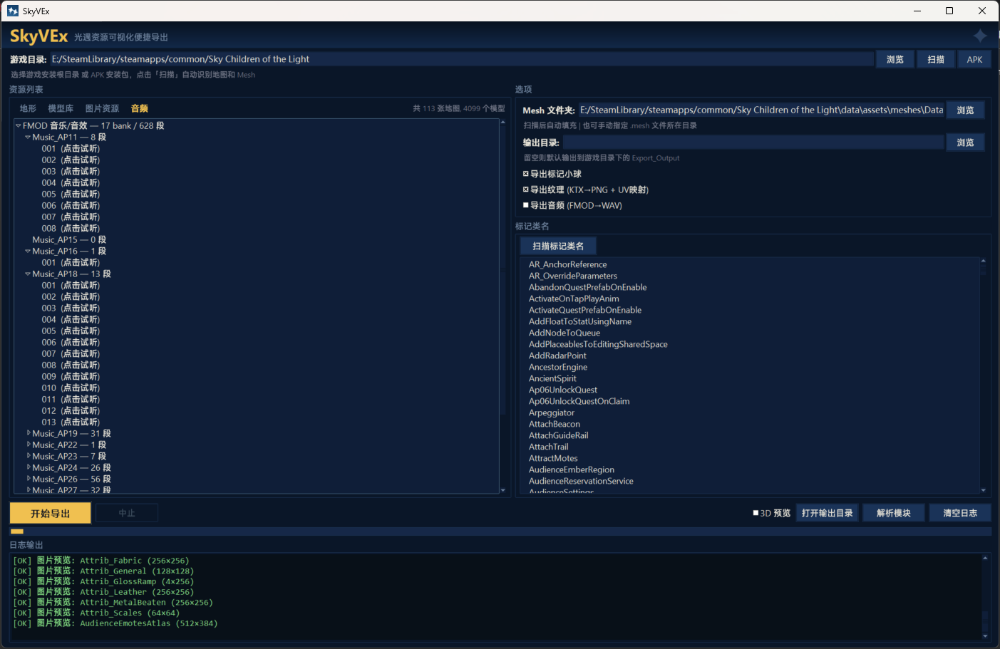

# SkyVEx

**光遇资源可视化便捷导出**（Convenient Visualization and Export of Sky: Children of the Light Assets）

《光·遇》资源导出工具（可视化界面）— 地图与模型几何（OBJ）、纹理（PNG）、音频（WAV）。

[中文](./README-zh.md) | [English](./README.md)

## 这个项目是什么

一个自包含的图形化工具，把光遇游戏数据导出成开放格式：地图与模型转 Wavefront
OBJ、纹理转 PNG、音频转 WAV。**界面、地图→OBJ 导出引擎、`.bin`/`.mesh` 解析器、
3D 预览、纹理管线、音频导出编排全部是 SkyVEx 原创代码**。地形解码器
（`Sky_Bstbake.py`）、一个可选的备用后端（`meshes2obj_json.py`）以及
`meshoptimizer` / `vgmstream` 二进制为第三方，**原样使用**，保留原作者署名与许可。

功能：

- **一键扫描游戏目录** — 选择游戏安装路径，自动识别所有地图和 Mesh 文件
- **APK 提取** — 直接打开光遇 APK 安装包，无需 PC 端游戏即可提取资源
- **分页资源浏览** — 四个标签页（地形 / 模型库 / 图片资源 / 音频），按场景分组的地图树、按前缀分组的 4000+ 独立模型、KTX 纹理图库、可展开到各段的 FMOD 音频 bank
- **3D 预览** — 实时 OpenGL 预览，支持地形顶点着色（材质混合 + AO）和顶部柔光；点击任意地图或模型即可预览
- **2D 图片预览** — 在图片资源标签页点击任意 KTX 纹理即可解码预览（BC1/BC3/BC4/BC5/BC6H/BC7）
- **音频试听与导出** — 在音频标签页展开 bank、点击某段即可试听（再点暂停）；一键把 FMOD `.streams.bank` 音乐/音效批量导出为 WAV（内置 vgmstream 解码）
- **按材质分组地形导出** — 地形 OBJ 按材质 ID 拆分，共享材质表（MTL），可直接在 Blender 中分配材质
- **独立模型导出** — 浏览并批量导出单个 `.mesh` 模型（道具、角色、物件）为 OBJ，不限于地形地图
- **标记类名扫描** — 从 `.bin` 文件扫描标记类名，自由勾选要导出的标记类型
- **纹理提取** — KTX → PNG，按格式分别解码（BC1/BC3/BC4/BC5/BC6H/BC7），OBJ 内 UV 映射，MTL 内 `map_Kd` 材质引用
- **可插拔后端系统** — 运行时切换原生 / 纯 Python 解析器
- **高 DPI 适配** — 高分屏 / 缩放显示下界面清晰不模糊
- **光遇风格暗色主题** — 深蓝配色，还原游戏视觉风格

> **来源标注：** 每个源文件顶部都写有归属头，说明它由谁编写、来自哪个仓库、
> 什么许可。第三方许可见 [NOTICE](./NOTICE)。

## 截图

| 地形 + 3D 预览 | 模型库 |
|----------------|--------|
|  |  |

| 图片预览 | 音频标签 |
|----------|----------|
|  |  |

## 依赖

Python 3.8+

```bash
pip install -r tool/scripts/requirements.txt
# lz4  Pillow  texture2ddecoder  PyOpenGL
```

- `lz4` — 地形（LOD0）解压**必需**。
- `Pillow` + `texture2ddecoder` — 纹理（KTX→PNG）导出和 2D 图片预览需要。
- `PyOpenGL` — 3D 预览面板需要（`PyOpenGL_accelerate` 可选）。

用于精细地形的 `meshoptimizer` 原生解码库已**预编译随附**于
`tool/scripts/_meshopt/lib/meshoptimizer.dll`（由
[zeux/meshoptimizer](https://github.com/zeux/meshoptimizer)(MIT) 官方源码自行
编译），**不是** pip 依赖。

音频导出/试听通过内置的 **vgmstream** CLI 解码（`tool/scripts/_vgmstream/`，仅
Windows），同样不是 pip 依赖；试听播放用标准库 `winsound`。

## 使用方法

### GUI（推荐）

**Windows：** 双击项目根目录的 `SkyVEx.exe` 即可启动。

或通过命令行运行：

```bash
cd tool/scripts
python gui.py
```

1. **浏览** 选择游戏安装目录，点击 **扫描** — 或点击 **APK** 直接打开 APK 安装包
2. 通过标签页浏览资源：**地形** 查看地图、**模型库** 查看独立模型、**图片资源** 查看 KTX 纹理
3. 勾选 **3D 预览** 实时查看任意地图或模型的 OpenGL 渲染效果；点击图片可查看 2D 预览
4. 点击 **扫描标记类名** 发现标记类型，按需开关标记、纹理导出，设置输出目录
5. 点击 **开始导出** — 同时导出选中的地图和独立模型

### 命令行

```bash
cd tool/scripts
python bintojson.py Objects.level.bin                        # bin → json
python Sky_Bstbake.py --unpack BstBaked.meshes --export-obj  # 仅地形（上游工具）
```

地图/模型导出由 GUI 驱动；引擎在 `exporter.py`，由 `gui.py` 导入调用，不单独运行。

## 文件结构

```
SkyVEx.exe                         # Windows 启动器（由 SkyVEx.py 构建）
SkyVEx.py                          # 启动器入口脚本
│
tool/scripts/
│  [原创 — lingyunalingyun]
├── gui.py                     # 可视化界面 & 纹理管线
├── exporter.py                # 地图 → OBJ/MTL 组装引擎
├── backends.py                # 可插拔后端注册层
├── mesh_parser.py             # 纯 Python .mesh 解析器（全版本）
├── preview3d.py               # OpenGL 3D 预览面板
├── bintojson.py               # TGCL .bin → dict/JSON 解析器（格式参考 Miau）
│
│  [第三方 — 原样，详见各文件头]
├── Sky_Bstbake.py             # 地形 .meshes 解码器 — ThatSkyOldServer/SkyBstbake (MIT)
├── meshes2obj_json.py         # 可选备用 .meshes 后端 — 县小威 移植自 that-sky-project (LGPL-2.1)
└── _meshopt/
    └── lib/
        └── meshoptimizer.dll  # zeux/meshoptimizer (MIT)，自行编译
```

每个脚本文件头部都写有归属头。第三方许可明细见 [NOTICE](./NOTICE)。

## 第三方文件

两个第三方源文件均**原样**取自各自上游仓库（仅在顶部加了 SkyVEx 归属头注释）：

| 文件 | 上游 | 许可 |
|------|------|------|
| `Sky_Bstbake.py` | [ThatSkyOldServer/SkyBstbake](https://github.com/ThatSkyOldServer/SkyBstbake) — checion (雨人) & Heriel (落秋) | MIT |
| `meshes2obj_json.py` | 县小威 — 移植自 [that-sky-project](https://github.com/that-sky-project/that-sky-level) | LGPL-2.1 |

`meshoptimizer.dll` 由 [zeux/meshoptimizer](https://github.com/zeux/meshoptimizer)
(MIT) 官方源码编译。

## OBJ 输出内容

| 数据 | 说明 |
|------|------|
| 地形 | 地面网格按材质 ID 拆分，共享 MTL 材质表，顶点着色 + AO |
| 模型（地图内） | 场景物体，已按实例应用变换矩阵，X/Z 轴翻转适配 Blender |
| 模型（独立） | 单个 `.mesh` 文件导出至 `Meshes/` 子文件夹，含 UV |
| 标记 | 交互点位置的小八面体标记（可选），按类名着色 |
| 纹理 | PNG 文件 + `map_Kd` 材质引用（可选） |

## 工作原理（格式详解）

SkyVEx 读三类文件，全部从原始字节手工解析；下面的布局是通过分析还原、并对照公开
参考（仅字节布局，不含任何第三方解析代码）交叉验证过的。

### `.mesh` — 独立模型（`mesh_parser.py`）

`.mesh` 文件开头 `0x00` 处是一个 32 位**版本号**。支持 `0x17`–`0x20`，用同一套
解析器统一处理，分两大类：

**非压缩（`0x17`–`0x1D`）。** 顶点/法线/UV/索引块位于头部之后的固定偏移。位置为
3× `float32`（16 字节步长），UV 为 `float32` 对，索引为 `uint32`。头部有两种变体：
`≤0x19` 通过扫描第一个 `0x01` 标记字节来定位顶点数，`0x1A`–`0x1D` 则从固定偏移读取。

**压缩（`0x1E`–`0x20`）。** 文件主体是一整个 **LZ4** 块。正确找到它是关键：

1. `0x48` 处是 `animated` 标志。
2. **挂点标记（attach-point markers）** — `0x4A` 处一个 `uint32` **数量**，后面跟
   这么多条固定 **112 字节** 的记录。它们是命名的绑定锚点（例如斗篷的
   `Capestar_Marker_1..5`，配饰靠它挂到身体上）。绝大多数模型数量为 `0`，斗篷通常是 `5`。
3. 于是 LZ4 载荷真正的起点是 `payload_off = 0x4E + 数量 * 112`（`≥0x20`）。
   过去写死 `0x4E`（当作从来没有标记）正是少数斗篷模型解析失败的原因。
4. 载荷头是三个 `int32`：`is_compressed`、`compressed_size`、`uncompressed_size`，
   据此把块 LZ4 解压到指定大小。

解压后的缓冲里，几何数据可能以**压缩打包**形式存储以省空间 —— 这正是文件名里那些
标志位在告诉你的：

| 标志 | 含义 | SkyVEx 如何解码 |
|------|------|-----------------|
| `ZipPos` | 位置为 10-bit **量化**（一个 `uint32` 把 X/Y/Z 各压进 10 bit） | 按网格 AABB 反量化回 `float32` |
| `ZipUvs` | UV 为 16-bit **量化** | 按每个网格的 UV 最小/最大值反量化 |
| `StripNorm` | 法线被丢弃以省空间 | 跳过，由建模软件重算 |
| `StripAnim` / `CompOcc` | 动画/遮挡数据被剥离或压实 | 遍历缓冲时处理 |

带动画的模型后面还跟骨骼权重（每顶点 4 索引 + 4 权重）和内嵌骨架。

### `.meshes` — 地形/地图块（`backends.py`、`Sky_Bstbake.py`）

`.meshes` 是一个 `LVL0` 容器：4 字节魔数、`0x04` 处一个 `uint32` `file_version`，
再是一张命名的 4 字符**段（segment）**表（`DESC`、`LOD0`、`GEO0`、`METR`），每段带
偏移和长度。两个互补后端读取两个不同的段：

- **`LOD0`（默认，BstBake）** — LZ4 压缩的*烘焙*地形，由 `Sky_Bstbake.py` 按 patch
  拆分。它带**材质颜色**，所以驱动了彩色地形预览和按材质导出。版本门槛：`≥55` 有
  `METR`，`≥57` 有 `GEO0`，`≥60` 有额外字段。
- **`GEO0`（可选，meshopt）** — 用 meshoptimizer 顶点编码的几何，由原生
  `meshoptimizer.dll` 或纯 Python 的 `meshes2obj_json.py` 解码。版本 `0x3C`/`0x3D`，
  无顶点颜色。

### 纹理（`gui.py`）

KTX 纹理按其 `glInternalFormat` 读取，按块压缩格式（BC1 / BC3 / BC4 / BC5 / BC6H /
BC7）经 `texture2ddecoder` 解码，做 BGRA→RGBA 通道交换，导出为 PNG，并在 MTL 里写入
对应的 `map_Kd`。

### `.bin` — 场景/物体摆放（`bintojson.py`）

TGCL `.bin` 文件列出物体实例（含每实例变换）和交互标记。`bintojson.py` 遍历这个结构，
供导出器摆放地图内模型、生成标记。

### 支持版本一览

| 类型 | 版本 | 说明 |
|------|------|------|
| `.mesh` | `0x17`–`0x20` | 非压缩 `0x17`–`0x1D`，LZ4 `0x1E`–`0x20`，含 `ZipPos`/`ZipUvs` 与挂点标记 |
| `.meshes` LOD0 | `file_version ≥ 55` | 烘焙地形，带材质颜色 |
| `.meshes` GEO0 | `0x3C` / `0x3D` | meshopt 几何，无颜色 |

## 构建 exe

发布的 `SkyVEx.exe` 是**独立单文件包**（目标机器无需安装 Python），用
[PyInstaller](https://pyinstaller.org/) 从 `SkyVEx.spec` 构建：

```bash
pip install pyinstaller
pyinstaller --noconfirm --clean SkyVEx.spec
```

该 spec 以 `tool/scripts/gui.py` 为入口，把同目录脚本、`meshoptimizer.dll`、图标和
许可证文件作为数据一起打包，这样冻结后的 `SCRIPT_DIR`（`sys._MEIPASS`）就能在运行时
按路径导入它们。输出为 `dist/SkyVEx.exe`。

另有一个轻量替代：源码启动器 `SkyVEx.py`，它只是用外部 Python 拉起 `gui.py` —— 用
`pyinstaller --onefile --noconsole --icon=icon.ico --name SkyVEx SkyVEx.py` 构建，但
这种版本仍需目标机器装有 Python。

## 常见问题

| 问题 | 解决 |
|------|------|
| 缺少 `lz4` | `pip install lz4`（地形必需） |
| 地形 0 顶点 | 确认 `_meshopt/lib/meshoptimizer.dll` 存在且已装 `lz4` |
| 模型缺失 | 需从游戏资源包 `Data/Meshes/Bin` 提取 `.mesh` 文件 |
| 纹理导出失败 | `pip install texture2ddecoder Pillow` |
| 3D 预览不可用 | `pip install PyOpenGL` |

## 致谢

- **GUI、导出引擎、`.bin`/`.mesh` 解析器、3D 预览、纹理管线、后端系统** — lingyunalingyun（本项目原创代码）。
- **地形解码器** `Sky_Bstbake.py` — checion (雨人) & Heriel (落秋)，[ThatSkyOldServer/SkyBstbake](https://github.com/ThatSkyOldServer/SkyBstbake) (MIT)。
- **可选 `.meshes` 后端** `meshes2obj_json.py` — 县小威 (XiaoWei)，移植自 [that-sky-project](https://github.com/that-sky-project/that-sky-level) (LGPL-2.1)。
- **原生解码库** `meshoptimizer.dll` — [Arseny Kapoulkine (zeux)](https://github.com/zeux/meshoptimizer) (MIT)。
- **格式参考（公开字节布局，非代码）：** Miau — [Sky-.bin-reader](https://github.com/Miau0x1/Sky-.bin-reader)；kfhammond — [SkyModelViewer](https://github.com/kfhammond/SkyModelViewer)。

## 许可证

SkyVEx 自身代码以 **MIT 许可证** 发布 — 见 [LICENSE](./LICENSE)。

`meshes2obj_json.py` 以 **LGPL-2.1** 发布（仅该文件）— 详见文件头，完整许可证
全文见 [licenses/LGPL-2.1.txt](./licenses/LGPL-2.1.txt)。第三方组件
保留各自原始许可，见 [NOTICE](./NOTICE)。
