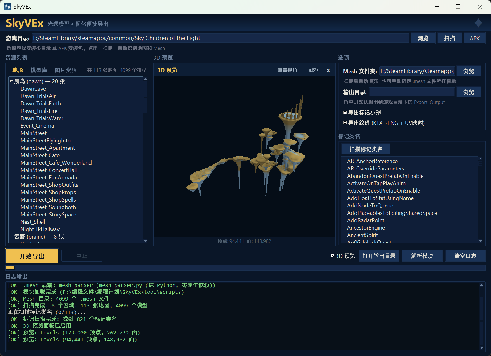

# SkyVEx

**Convenient Visualization and Export of Sky: Children of the Light Assets**

GUI tool for batch-exporting *Sky: Children of the Light* assets — map & model
geometry (OBJ), textures (PNG), and audio (WAV).

[中文](./README-zh.md) | [English](./README.md)

## What this project is

A self-contained graphical tool for turning Sky game data into open formats:
maps and models to Wavefront OBJ, textures to PNG, and audio to WAV. The GUI,
the level→OBJ export engine, the `.bin` and `.mesh` parsers, the 3D preview, the
texture pipeline and the audio-export orchestration are all **original SkyVEx
code**. The terrain decoder (`Sky_Bstbake.py`), one optional alternate backend
(`meshes2obj_json.py`) and the `meshoptimizer` / `vgmstream` binaries are
third-party, used **unmodified** with their original authorship and licenses
intact.

Features:

- **One-click game directory scanning** — point at your game install, auto-discover all maps and mesh files
- **APK extraction** — open a Sky APK directly and extract game assets without a PC install
- **Tabbed resource browser** — four-tab layout (Terrain / Models / Images / Audio) with scene-grouped map tree, 4000+ individual meshes grouped by prefix, KTX texture gallery, and FMOD audio banks expandable to their subsongs
- **3D preview** — real-time OpenGL preview with vertex colors (terrain material blending) and top-down soft lighting; click any map or model to preview
- **2D image preview** — click any KTX texture in the Images tab to decode and preview (BC1/BC3/BC4/BC5/BC6H/BC7)
- **Audio preview & export** — expand a bank in the Audio tab and click any subsong to hear it (click again to stop); batch-export all FMOD `.streams.bank` music/SFX to WAV via bundled vgmstream
- **Per-material terrain export** — terrain OBJ split by material ID with a shared material table (MTL), ready for Blender material assignment
- **Individual mesh export** — browse and batch-export standalone `.mesh` models (props, characters, items) to OBJ, not just terrain maps
- **Marker class scanning** — scan marker class names from `.bin` files, pick which marker types to export
- **Texture extraction** — KTX → PNG with per-format decoding (BC1/BC3/BC4/BC5/BC6H/BC7), UV mapping in OBJ, `map_Kd` material references in MTL
- **Pluggable backend system** — swap between native and pure-Python parsers at runtime
- **DPI-aware rendering** — crisp UI on high-DPI / scaled displays
- **Sky-styled dark theme** — deep navy palette inspired by the game's visual identity

> **Attribution:** every source file carries a provenance header stating who
> wrote it, which repository it came from, and under which license. See
> [NOTICE](./NOTICE) for the third-party licenses.

## Screenshot



## Requirements

Python 3.8+

```bash
pip install -r tool/scripts/requirements.txt
# lz4  Pillow  texture2ddecoder  PyOpenGL
```

- `lz4` — **required** for terrain (LOD0) decompression.
- `Pillow` + `texture2ddecoder` — needed for texture (KTX→PNG) export and 2D image preview.
- `PyOpenGL` — needed for the 3D preview panel (`PyOpenGL_accelerate` optional).

The `meshoptimizer` native decoder used for fine terrain is **shipped prebuilt**
at `tool/scripts/_meshopt/lib/meshoptimizer.dll` (self-compiled from
[zeux/meshoptimizer](https://github.com/zeux/meshoptimizer), MIT). It is **not**
a pip dependency.

Audio export/preview shells out to the prebuilt **vgmstream** CLI shipped at
`tool/scripts/_vgmstream/` (Windows only). Also not a pip dependency; audio
playback uses the standard-library `winsound`.

## Usage

### GUI (recommended)

**Windows:** Double-click `SkyVEx.exe` in the project root.

Or run from the command line:

```bash
cd tool/scripts
python gui.py
```

1. **Browse** to your game install directory, click **Scan** — or click **APK** to open an APK file directly
2. Browse resources using tabs: **Terrain** for maps, **Models** for individual meshes, **Images** for KTX textures
3. Toggle **3D Preview** to preview any map or model with real-time OpenGL rendering; click any image for a 2D preview
4. Click **Scan Marker Classes** to discover marker types, then toggle markers, textures, and adjust the output directory
5. Click **Start Export** — exports both selected maps and individual models

### CLI

```bash
cd tool/scripts
python bintojson.py Objects.level.bin                        # bin → json
python Sky_Bstbake.py --unpack BstBaked.meshes --export-obj  # terrain only (upstream tool)
```

Map/model export is driven by the GUI; the engine lives in `exporter.py` and is
imported by `gui.py` rather than run standalone.

## File structure

```
SkyVEx.exe                         # Windows launcher (build from SkyVEx.py)
SkyVEx.py                          # Launcher entry point
│
tool/scripts/
│  [Original — lingyunalingyun]
├── gui.py                     # GUI frontend & texture pipeline
├── exporter.py                # Level → OBJ/MTL assembly engine
├── backends.py                # Pluggable backend registry
├── mesh_parser.py             # Pure-Python .mesh parser (all versions)
├── preview3d.py               # OpenGL 3D preview panel
├── bintojson.py               # TGCL .bin → dict/JSON parser (format ref: Miau)
├── audio_export.py            # FMOD .streams.bank → WAV (drives vgmstream)
│
│  [Third-party — verbatim, see each file's header]
├── Sky_Bstbake.py             # Terrain .meshes decoder — ThatSkyOldServer/SkyBstbake (MIT)
├── meshes2obj_json.py         # Optional alt .meshes backend — 县小威 port of that-sky-project (LGPL-2.1)
├── _meshopt/
│   └── lib/
│       └── meshoptimizer.dll  # zeux/meshoptimizer (MIT), self-compiled
└── _vgmstream/                # vgmstream-cli.exe + runtime DLLs (audio decode)
```

Every script file begins with a provenance header. See [NOTICE](./NOTICE) for
third-party license details.

## Third-party files

Both third-party source files are used **unmodified** from their upstream
repositories (only a SkyVEx attribution header is prepended):

| File | Upstream | License |
|------|----------|---------|
| `Sky_Bstbake.py` | [ThatSkyOldServer/SkyBstbake](https://github.com/ThatSkyOldServer/SkyBstbake) — checion (雨人) & Heriel (落秋) | MIT |
| `meshes2obj_json.py` | 县小威 (XiaoWei) — port of [that-sky-project](https://github.com/that-sky-project/that-sky-level) | LGPL-2.1 |

Bundled binaries (used as-is): `meshoptimizer.dll` is compiled from
[zeux/meshoptimizer](https://github.com/zeux/meshoptimizer) (MIT) official
source; `_vgmstream/` is the official [vgmstream](https://github.com/vgmstream/vgmstream)
Windows CLI build (vgmstream-cli.exe + its decoder DLLs). See
[NOTICE](./NOTICE) and `tool/scripts/_vgmstream/COPYING` for their licenses.

## Output

| Data | Description |
|------|-------------|
| Terrain | Ground mesh split by material ID, shared MTL material table, vertex colors and AO |
| Models (in-map) | Scene objects with per-instance transforms applied, X/Z-flipped for Blender |
| Models (standalone) | Individual `.mesh` files exported to `Meshes/` subfolder with UVs |
| Markers | Small octahedron pins at interaction points (optional), colored per class |
| Textures | PNG files + `map_Kd` material references (optional) |
| Audio | WAV per subsong under `Audio/<bank>/<index>_<stream name>.wav` (optional) |

## How it works (format internals)

SkyVEx reads several kinds of files. All parsing is done from the raw bytes; the
layouts below were recovered by inspection and cross-checked against public
references (byte layouts only — no third-party parser code).

### `.mesh` — individual models (`mesh_parser.py`)

A `.mesh` file starts with a 32-bit **version** at offset `0x00`. Versions
`0x17`–`0x20` are supported through one unified parser, which splits into two
families:

**Uncompressed (`0x17`–`0x1D`).** Vertex/normal/UV/index blocks sit at fixed
offsets after the header. Positions are 3× `float32` (16-byte stride), UVs are
`float32` pairs, indices are `uint32`. Two header variants exist: `≤0x19`
locates the vertex count by scanning for the first `0x01` marker byte, `0x1A`–
`0x1D` reads it from a fixed offset.

**Compressed (`0x1E`–`0x20`).** The bulk of the file is a single **LZ4** block.
Reaching it correctly is the interesting part:

1. `animated` flag at `0x48`.
2. **Attach-point markers** — a `uint32` *count* at `0x4A`, followed by that
   many fixed **112-byte** records. These are named anchor points (for example
   a cape's `Capestar_Marker_1..5`, where an accessory pins to the body). Most
   meshes have a count of `0`; capes typically carry `5`.
3. The LZ4 payload therefore begins at `payload_off = 0x4E + count * 112`
   (for `≥0x20`). Assuming a fixed `0x4E` — as if there were never any markers —
   is what used to break the handful of cape meshes.
4. The payload header is three `int32`s: `is_compressed`, `compressed_size`,
   `uncompressed_size`. The block is LZ4-decompressed to that size.

Inside the decompressed buffer the geometry can be stored **packed** to save
space — this is what the filename flags advertise:

| Flag | Meaning | How SkyVEx decodes it |
|------|---------|-----------------------|
| `ZipPos` | Positions are 10-bit **quantized** (a `uint32` packs X/Y/Z into 3× 10 bits) | Dequantized against the mesh AABB back to `float32` |
| `ZipUvs` | UVs are 16-bit **quantized** | Dequantized against per-mesh UV min/max |
| `StripNorm` | Normals dropped to save space | Skipped; recomputed by the modeling app |
| `StripAnim` / `CompOcc` | Animation/occlusion streams stripped or compacted | Handled while walking the buffer |

Bone weights (4 indices + 4 weights per vertex) and an embedded skeleton follow
for animated meshes.

### `.meshes` — terrain / map chunks (`backends.py`, `Sky_Bstbake.py`)

A `.meshes` file is an `LVL0` container: a 4-byte magic, a `uint32`
`file_version` at `0x04`, then a table of named 4-char **segments** (`DESC`,
`LOD0`, `GEO0`, `METR`), each with an offset and length. Two complementary
backends read two different segments:

- **`LOD0` (default, BstBake)** — LZ4-compressed *baked* terrain, split per
  patch by `Sky_Bstbake.py`. This carries **material colors**, so it drives the
  colored terrain preview and per-material export. Feature gates by version:
  `METR` from `≥55`, `GEO0` from `≥57`, extra fields from `≥60`.
- **`GEO0` (optional, meshopt)** — geometry encoded with the meshoptimizer
  vertex codec, decoded either by the native `meshoptimizer.dll` or the
  pure-Python `meshes2obj_json.py`. Versions `0x3C`/`0x3D`. No vertex colors.

### Textures (`gui.py`)

KTX textures are read by their `glInternalFormat`, decoded per block-compression
format (BC1 / BC3 / BC4 / BC5 / BC6H / BC7) via `texture2ddecoder`, channel-
swapped BGRA→RGBA, and written out as PNG with matching `map_Kd` entries in the
MTL.

### `.bin` — scene / object placement (`bintojson.py`)

The TGCL `.bin` files list object instances (with per-instance transforms) and
interaction markers. `bintojson.py` walks this structure so the exporter can
place in-map models and emit marker pins.

### Audio (`audio_export.py`)

Sky ships music and SFX as FMOD Studio banks under `Data/Audio/Fmod/`. Each
sound event is three files — `X.bank` (event metadata), `X.assets.bank` (short
samples, encrypted) and `X.streams.bank` (streamed music/ambience). The streamed
banks hold many "subsongs" encoded as Custom Vorbis or FMOD FADPCM.

`audio_export.py` doesn't decode audio itself — it shells out to the bundled
`vgmstream-cli`. It enumerates a bank's subsongs (`-m`) to build the Audio tab,
decodes a single subsong for click-to-preview (played with `winsound`), and
batch-exports every subsong to `Audio/<bank>/<index>_<stream name>.wav`
(`-s 1 -S 0 -o "?03s_?n.wav"`). The encrypted `.assets.bank` samples are skipped.

### Supported versions at a glance

| Kind | Versions | Notes |
|------|----------|-------|
| `.mesh` | `0x17`–`0x20` | uncompressed `0x17`–`0x1D`, LZ4 `0x1E`–`0x20`, incl. `ZipPos`/`ZipUvs` and attach-point markers |
| `.meshes` LOD0 | `file_version ≥ 55` | baked terrain, material colors |
| `.meshes` GEO0 | `0x3C` / `0x3D` | meshopt geometry, no colors |

## Building the exe

The released `SkyVEx.exe` is a **standalone one-file bundle** (no Python needed
on the target machine), built with [PyInstaller](https://pyinstaller.org/) from
`SkyVEx.spec`:

```bash
pip install pyinstaller
pyinstaller --noconfirm --clean SkyVEx.spec
```

The spec uses `tool/scripts/gui.py` as the entry point and bundles the sibling
scripts, the `meshoptimizer.dll`, the icon, and the license files as data, so
the frozen `SCRIPT_DIR` (`sys._MEIPASS`) can path-import them at runtime. The
output is `dist/SkyVEx.exe`.

A lightweight alternative is the source launcher `SkyVEx.py`, which just spawns
`gui.py` with an external Python — build it with
`pyinstaller --onefile --noconsole --icon=icon.ico --name SkyVEx SkyVEx.py`, but
that variant still needs Python installed on the target machine.

## Troubleshooting

| Problem | Fix |
|---------|-----|
| `lz4` not found | `pip install lz4` (required for terrain) |
| Terrain 0 vertices | Ensure `_meshopt/lib/meshoptimizer.dll` is present and `lz4` installed |
| Models missing | Need `.mesh` files extracted from the game's `Data/Meshes/Bin` |
| Texture export fails | `pip install texture2ddecoder Pillow` |
| 3D preview not available | `pip install PyOpenGL` |

## Credits

- **GUI, export engine, `.bin`/`.mesh` parsers, 3D preview, texture pipeline, audio export, backend system** — lingyunalingyun (this project's original code).
- **Terrain decoder** `Sky_Bstbake.py` — checion (雨人) & Heriel (落秋), [ThatSkyOldServer/SkyBstbake](https://github.com/ThatSkyOldServer/SkyBstbake) (MIT).
- **Optional `.meshes` backend** `meshes2obj_json.py` — 县小威 (XiaoWei), port of [that-sky-project](https://github.com/that-sky-project/that-sky-level) (LGPL-2.1).
- **Native decoder** `meshoptimizer.dll` — [Arseny Kapoulkine (zeux)](https://github.com/zeux/meshoptimizer) (MIT).
- **Audio decoder** `vgmstream-cli` — [vgmstream](https://github.com/vgmstream/vgmstream) (official Windows build, bundled unmodified).
- **Format references (public byte layouts, no code):** Miau — [Sky-.bin-reader](https://github.com/Miau0x1/Sky-.bin-reader); kfhammond — [SkyModelViewer](https://github.com/kfhammond/SkyModelViewer).

## License

SkyVEx's own code is released under the **MIT License** — see [LICENSE](./LICENSE).

`meshes2obj_json.py` is licensed under **LGPL-2.1** (that file only) — see its
header and the full license text at [licenses/LGPL-2.1.txt](./licenses/LGPL-2.1.txt).
Third-party components retain their original licenses; see
[NOTICE](./NOTICE).
